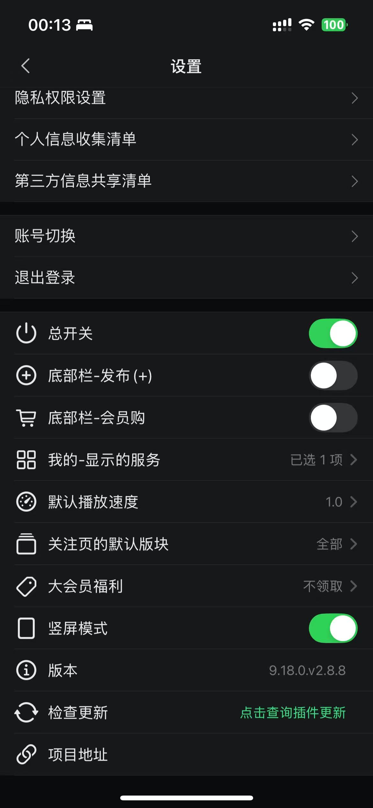

# BiliBiliPlus


一个通过 **iOS 逆向分析** 实现的 **无广告版哔哩哔哩** 客户端插件，在保留原有功能的基础上，专注于 **广告移除与体验优化**。

> **本项目基于开源项目 [TouchFriend/BiliBiliMApp](https://github.com/TouchFriend/BiliBiliMApp) 二次修改而来**，原作者为 [TouchFriend](https://github.com/TouchFriend)。
> 本仓库仅在我的修改版本上继续适配哔哩哔哩 9.18.0，并调整了设置界面与分发方式。
> 原项目采用 MIT License，本仓库保留原始许可证与版权声明。

---

## 📌 项目说明

- 本项目只提供 **dylib 插件**，**不提供已注入插件的 IPA**
- 适用于 **非越狱设备**（需要自行对官方 App 脱壳、注入并重签名）
- 基于哔哩哔哩官方 App 进行逆向分析与功能修改
- 仅修改客户端本地逻辑，不涉及任何服务器或接口行为
- 当前适配版本：**哔哩哔哩 9.18.0**（`tv.danmaku.bilianime`）

如果你在寻找 **越狱环境** 下的方案，可参考原作者的以下项目：

👉 [去除哔哩哔哩广告插件（越狱版）](https://github.com/TouchFriend/BiliBiliTweak)

---

## ✨ 功能特性

- 🚫 去除启动页、首页信息流、详情页、直播等广告
- 🚫 去除视频播放一段时间后出现的「视频下方 / 评论区广告」（含倒计时提示）
- 🚫 去除相关视频列表中的广告与推广卡片
- 👁️ 可选隐藏底部「发布 +」、会员购及「我的」中的不常用服务
- ⏩ 新增 **3 倍速播放功能**
- ⚙️ 修改默认播放速度
- 📑 修改关注页的默认版块
- 🎁 大会员福利（B 币券 / 观影券）手动选择
- 🎨 设置项图标按功能标题显示（不再统一使用骷髅图标）
- 🔄 新增「检查更新」（设置页点击查询 GitHub 最新版本）
- 🧩 「我的」页面服务入口支持手动多选显示（默认全部隐藏）
- ⭐ 会员中心大积分：每日自动签到、手动签到、大积分中心入口，并在「我的」硬币旁显示大积分数额

---

## 📸 效果图

| 设置界面 | 3 倍速播放 |
| --- | --- |
|  |  |

| 首页效果 |
| --- |
|  |

---

## 🔧 相对于原开源项目的改动

### 1. 适配哔哩哔哩 9.18.0

9.18.0 修改了若干内部实现，导致原有 hook 全部指向不存在的 selector / 类，本仓库已逐项适配：

| 问题 | 原因 | 修复 |
| --- | --- | --- |
| 会员购、底部发布 +、广告去除全部失效 | `BFCRequest` 初始化方法去掉了 `priority:` 参数，原 hook 未生效，整个响应过滤管道没有接上 | 改为 hook `BFCRequest -handleFinishCallbackWithData:response:error:`，统一在响应回调入口过滤数据 |
| 底部「发布 +」开关无效 | 9.18 的 tab 数据中发布项没有 `tab_id` | 增加 `uri` 包含 `uper/center_plus`、`type == 3` 的兜底识别 |
| 会员购开关无效 | tab 数据结构变化 | 增加 `uri` 包含 `mall/home` 的兜底识别 |
| 首页仍出现广告 | 9.18 新增 `cm_single_v1`、`cm_single_v7`、`cm_single_v9` 等广告卡片类型 | 过滤所有 `cm_` 开头卡片，以及带 `ad_info` / `card_goto == "ad"` 的卡片 |
| 相关视频下方出现广告 | 9.18 详情页改用 `BBMediaUniteRelateObject` 模型，旧的卡片过滤不再覆盖 | hook `BBMediaDescUniteRelateVideoObject.relateVideos`，剔除 `BBMediaUniteRelateADObject` 与 `cmStock == YES` 的对象 |
| 播放一段时间后弹出视频下方广告（评论位置） | 9.18 改由 KMP / 新广告宿主展示 | 拦截 `BBAdUGCContext` 广告加载；拦截 `PlayerCommentAdHost`、`VideoDetailAdCommentNativeHost` 的 `showPanelType:` 与相关商品面板；隐藏倒计时 View |

### 2. 设置界面

- 「官网」改为本仓库地址
- 新增「原开源项目」入口，注明本项目来源
- 每个设置项按功能标题显示对应的 SF Symbols 图标，替换原来的统一骷髅图标
- 插件版本号更新为 `2.7.0`

### 3. 分发方式

- **不再提供注入后的 IPA**，仅提供编译好的 dylib
- 仓库内 `Release/libBiliBiliMDDylib.dylib` 为当前版本构建产物
- 需要自行准备已脱壳的哔哩哔哩 9.18.0 App 进行注入

---

## 🛠️ 从源码构建（开发者）

### 1️⃣ 环境准备

- macOS + Xcode
- [MonkeyDev](https://github.com/AloneMonkey/MonkeyDev)
- [Theos](https://github.com/theos/theos)
- 本项目默认使用 Theos 路径 `/opt/theos`；如果安装在其他路径，可在编译时传入 `MonkeyDevTheosPath=你的 Theos 路径`

### 2️⃣ 克隆项目

```bash
git clone https://github.com/logisme/BiliBiliPlus.git
cd BiliBiliPlus
```

### 3️⃣ 只编译 dylib（推荐）

```bash
xcodebuild \
  -project BiliBiliMD.xcodeproj \
  -target BiliBiliMDDylib \
  -configuration Release \
  -sdk iphoneos \
  ARCHS=arm64 \
  CODE_SIGNING_ALLOWED=NO \
  CODE_SIGNING_REQUIRED=NO \
  CODE_SIGN_IDENTITY="" \
  MonkeyDevTheosPath=/opt/theos \
  ONLY_ACTIVE_ARCH=YES \
  build
```

构建产物：

```text
build/Release-iphoneos/libBiliBiliMDDylib.dylib
```

> 项目中的 `BiliBiliMD` App Target 仅用于 MonkeyDev 调试，不随本项目分发。

---

## 📦 自行注入 dylib

本项目不提供 IPA，也不提供脱壳 App。你需要自行准备**已脱壳**的哔哩哔哩 9.18.0 `bili-universal.app`，然后：

1. 将 `libBiliBiliMDDylib.dylib` 复制到：

```text
Payload/bili-universal.app/Frameworks/libBiliBiliMDDylib.dylib
```

2. 将 `libsubstrate.dylib` 一并复制到：

```text
Payload/bili-universal.app/Frameworks/libsubstrate.dylib
```

3. 将资源包 `NJBilibili.bundle` 复制到 App 根目录：

```text
Payload/bili-universal.app/NJBilibili.bundle
```

> 插件未定义 `NJ_TWEAK` 时按 MonkeyApp 分支运行，资源从 `[NSBundle mainBundle] pathForResource:@"NJBilibili.bundle"` 读取，因此 bundle 必须位于 `.app` 根目录。

4. 给主二进制添加 `LC_LOAD_DYLIB`：

```text
@executable_path/Frameworks/libBiliBiliMDDylib.dylib
```

可使用 `monkeyparser`、`insert_dylib` 或 MonkeyDev 自带的注入脚本完成。

5. 修正 dylib 的依赖与 install name：

```bash
install_name_tool -id @executable_path/Frameworks/libBiliBiliMDDylib.dylib \
  Payload/bili-universal.app/Frameworks/libBiliBiliMDDylib.dylib

install_name_tool -change /opt/theos/vendor/lib/libsubstrate.dylib \
  @executable_path/Frameworks/libsubstrate.dylib \
  Payload/bili-universal.app/Frameworks/libBiliBiliMDDylib.dylib
```

6. 使用任意重签名工具对 App 重签名后安装，例如：

- [Sideloadly](https://sideloadly.io/)
- [iOS App Signer](https://github.com/DanTheMan827/ios-app-signer)
- [SideStore](https://sidestore.io)
- [AltStore](https://altstore.io)

> dylib 使用官方包名 `tv.danmaku.bilianime`，若设备已安装官方哔哩哔哩，请先卸载或修改包名后再安装。

---

## ⚙️ 设置

安装并启动后，在「我的 → 设置」中找到注入的设置区：

- 总开关
- 底部栏：发布（+）、会员购
- 我的：显示的服务（多选，默认全部隐藏）
- 默认播放速度、关注页默认版块、大会员福利
- 大积分签到、大积分中心
- 竖屏模式、分享数据、版本、检查更新、官网、项目地址

修改总开关或部分功能后需要重启 App 才会完全生效。

---

## 📚 参考资料

- [iOS 逆向 - 哔哩哔哩增加 3 倍速播放（1）- 最大播放速度](https://juejin.cn/post/7582063437414285350)

---

## ⚠️ 免责声明

- 本项目仅用于 **iOS 逆向工程学习与技术研究**
- 不得用于任何商业用途或非法用途
- 请在下载/安装后 24 小时内删除相关文件
- 如涉及侵权问题，请联系仓库作者删除相关内容
- 本项目与哔哩哔哩官方无关

---

## ❤️ 致谢

- 原开源项目：[TouchFriend/BiliBiliMApp](https://github.com/TouchFriend/BiliBiliMApp)
- 原项目作者：[TouchFriend](https://github.com/TouchFriend)

感谢所有为 iOS 逆向生态做出贡献的开发者。如果本项目对你有帮助，欢迎 Star ⭐️ 支持。

---

## ⭐ Star History

[](https://star-history.com/#logisme/BiliBiliPlus&Date)

---

## License

[MIT License](LICENSE)。原始版权归原项目作者所有，本仓库修改部分同样遵循 MIT License。
